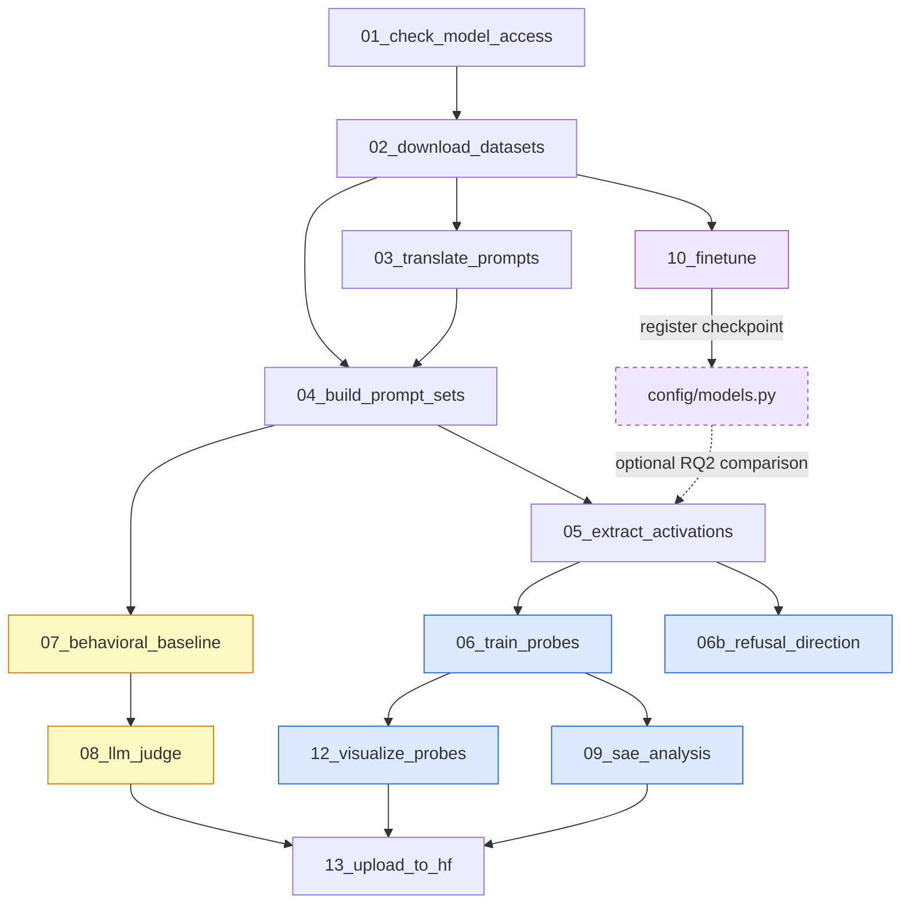

# cohere-safety-representations

Mechanistic study of how safety representations form across TinyAya model variants
(Base → Global → Regional) and across 6 languages (en, fr, ar, zh, sw, yo).

## Pipeline dependency graph



**Purple = finetuning branch** (produces new model weights; parallel to probe pipeline)  
**Blue = probe pipeline** (frozen model; extracts + classifies representations)  
**Yellow = behavioral evaluation** (generation + judge; parallel to probe pipeline)

The finetuned checkpoint can be registered in `config/models.py` and re-run through `05→06` to compare representations before vs. after safety training (RQ2).

---

## Quick start

```bash
pip install -r requirements.txt

# 1. Check model access (critical path)
python scripts/01_check_model_access.py --token $HF_TOKEN

# 2. Download datasets
python scripts/02_download_datasets.py --token $HF_TOKEN

# 3. Translate PKU-SafeRLHF to target languages via NLLB
python scripts/03_translate_prompts.py

# 4. Build matched harmful/harmless prompt sets
python scripts/04_build_prompt_sets.py

# 5. Sanity check — English × Global only (2-3 hours)
python scripts/05_extract_activations.py --model global --lang en --layers 18 24 30
python scripts/06_train_probes.py        --model global --lang en
jupyter lab notebooks/00_sanity_check.ipynb

# 6. Full sweep (after sanity check passes)
python scripts/07_behavioral_baseline.py --all
python scripts/08_llm_judge.py           --validate --labeled data/judge_gold_50.jsonl
python scripts/08_llm_judge.py           --all
python scripts/05_extract_activations.py --all
python scripts/06_train_probes.py        --all --alignment
python scripts/09_sae_analysis.py        --model global --lang en --layer 24 --train --analyse
```

## Experiment order (recommended)

1. **Behavioral baselines** (`07_behavioral_baseline.py`) — confirm unsafe/refusal gap exists
2. **Probe accuracy + silhouette** (`06_train_probes.py`) — main hypothesis test
3. **Cross-lingual direction alignment** (`06_train_probes.py --alignment`) — language-specificity
4. **SAE analysis** (`09_sae_analysis.py`) — most expensive; run last

## Project structure

```
config/          Language + model configs (update HF IDs once access confirmed)
data/
  raw/           Downloaded datasets (XSafety, Aya Red-teaming, PKU-SafeRLHF)
  processed/     Translations + extracted activations
  prompts/       Final harmful/harmless prompt sets per language
scripts/         Numbered pipeline scripts (01–09)
src/             Shared utilities (ModelWrapper, probes, judge)
notebooks/       00_sanity_check.ipynb
results/         Output: probes/, behavioral/, sae/, figures/
```

## Datasets

| Dataset | HF ID | What it is | How we use it |
|---------|-------|------------|---------------|
| XSafety | `Libra-learnmore/xsafety` | Multilingual safety benchmark, 2,800 prompts × 10 languages, 14 harm categories | Primary harmful prompt source + behavioral eval |
| Aya Red-teaming | `CohereForAI/aya_redteaming` | Multilingual red-teaming prompts, 8 languages, global vs. local harm annotations | Additional harmful prompts; global/local harm subspace analysis |
| PKU-SafeRLHF | `PKU-Alignment/PKU-SafeRLHF` | English preference pairs, 73k+ rows, safe/unsafe labels, 19 harm categories | Safety fine-tuning (SFT/DPO) via QLoRA; translated harmful source for non-en langs |
| Aya Eval Suite | `CohereLabs/aya_evaluation_suite` (dolly_machine_translated) | Native multilingual harmless prompts, ~200–1k per language | Harmless prompt source for probe training |
| LITMUS | `hasnat79/litmus` | English-only axiom-based safety dataset, ~20k prompts labeled safe/unsafe across 7 value dimensions (Civility, Duty, Empathy, Justice, Well-being, Wisdom, Information Seeking) | Additional English harmful source (unsafe subset); not in scope doc — added for volume |

### Native harmful prompts (no translation)

| Lang | XSafety | Aya Red-teaming | Total native |
|------|---------|-----------------|-------------|
| en | 2,771 | 1,008 | **3,779** |
| fr | 2,771 | 817 | **3,588** |
| ar | 2,779 | 951 | **3,730** |
| hi | 2,971 | 921 | **3,892** |
| fil | 0 | 1,163 | **1,163** |
| sw | 0 | 0 | **0** (NLLB only) |
| yo | 0 | 0 | **0** (NLLB only) |

### Fine-tuning vs probe training

**Probe training** — the model is frozen. You run prompts through it, extract hidden activations, then train a small linear classifier on top. Answers: *does the model already encode harmfulness in its representations, even if it doesn't refuse?* (RQ1)

**Fine-tuning (SFT/DPO)** — creates a new model checkpoint by updating weights. The goal is a "Safety-FT" version of TinyAya-Base so you can compare representations before vs. after safety training. Answers: *how do safety representations change as the model learns to be safer?* (RQ2)

They need different data:
- **Probes** → harmful/harmless prompts (just the prompt; need activations for both classes)
- **Fine-tuning** → prompt + response pairs (PKU-SafeRLHF), to teach the model to generate safer outputs

### Data counts by purpose

**Fine-tuning (PKU-SafeRLHF):**
- 20,000 pairs sampled on disk (from 73,907 total available)
- Scope target: 500 pairs for the primary Safety-FT checkpoint

**Probe training — harmful (native, no translation):**

| Lang | XSafety | Aya Red-teaming | Total native |
|------|---------|-----------------|-------------|
| en | 2,771 | 1,008 | 3,779 |
| fr | 2,771 | 817 | 3,588 |
| ar | 2,779 | 951 | 3,730 |
| hi | 2,971 | 921 | 3,892 |
| fil | 0 | 1,163 | 1,163 |
| sw | 0 | 0 | 0 (NLLB only) |
| yo | 0 | 0 | 0 (NLLB only) |

**Probe training — harmless (Aya Eval Suite, native):**

| Lang | Count |
|------|-------|
| en | 1,011 |
| fr | 275 |
| ar | 550 |
| hi | 275 |
| fil | 0 |
| sw | 275 |
| yo | 275 |

Balanced probe training is capped at ~275 per class for most languages based on raw prompt counts. However, the extracted activations (the actual input to probe training) are already balanced at **430 harmful / 430 harmless per language** (860 total) for all 6 core languages. Filipino needs an alternative harmless source.

**Behavioral evaluation (XSafety):**
~2,800 per language for en/fr/ar/hi. No XSafety for fil/sw/yo (Aya Red-teaming used instead).
XSafety is split 80/20 train/eval — the eval 20% (`harmful_eval.jsonl`) is held out for behavioral metrics and never seen during probe training.

### SFT → DPO pipeline notes

`run_dpo` loads from `base_hf_id=sft_dir` — it initializes from the SFT checkpoint for each sample size, then runs DPO on top. So `--method dpo` actually does SFT → DPO per sample size, which is the correct setup.

SFT then DPO on the same data is standard. The SFT teaches the model to generate safe responses; DPO then refines it using the preference signal (chosen vs rejected). This is exactly how Zephyr-β and most modern RLHF pipelines work.

Note: because the script always runs SFT first even when `--method dpo` is passed, running the DPO sweep will re-run and overwrite the SFT checkpoints in `models/finetuned_sweep/`. Not a problem, just worth knowing.

### Data sufficiency notes

**Fine-tuning (SFT / DPO):**
XSafety and Aya Red-teaming are prompts-only — no responses. SFT requires `(prompt, safe_response)` pairs; DPO requires `(prompt, chosen, rejected)` triplets. PKU-SafeRLHF is the correct and only source for this regardless of native prompt counts. The scope doc specifies 500 PKU pairs for fine-tuning, which is enough to produce a measurable representational shift with QLoRA. Native prompt counts are irrelevant here.

**Probe training (harmful vs harmless classification):**
Native harmful (~3,500–3,900 per language for en/fr/ar/hi) is sufficient. The binding constraint is harmless: Aya Eval provides ~275 native harmless prompts per language (except Filipino = 0). The extracted activations are balanced at **430/430 per language** for all 6 core languages (en, fr, ar, zh, sw, yo) — sufficient for both DiffMean and LogReg (5-fold CV) given d_model=2048. Filipino needs an alternative harmless source (NLLB-translated or LLM-rephrased).

**Behavioral evaluation:**
XSafety (~2,800 prompts per language) is the primary eval benchmark — separate from training data.

## Key decisions

| Choice | Decision | Rationale |
|---|---|---|
| Activation extraction | HuggingFace hooks | Broad model support; no TransformerLens porting needed |
| Probe types | DiffMean + LogReg (5-fold CV) | DiffMean = interpretable; LR = stronger accuracy signal |
| Translation | NLLB-200-distilled-1.3B | Good Swahili/Yoruba quality; swap for 3.3B if needed |
| Judge ensemble | GPT-4o + Command-R | Diverse, validated with Cohen's κ ≥ 0.7 before full run |
| SAE | TopK sparse autoencoder | Standard; 8× expansion, k=32 active features |
| SAE layer | 24 | Mid-late layers concentrate safety features (prior work) |


## Env
- cohere api key and huggingface api key in .env